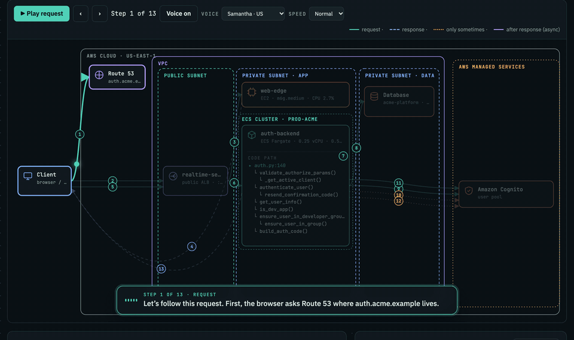
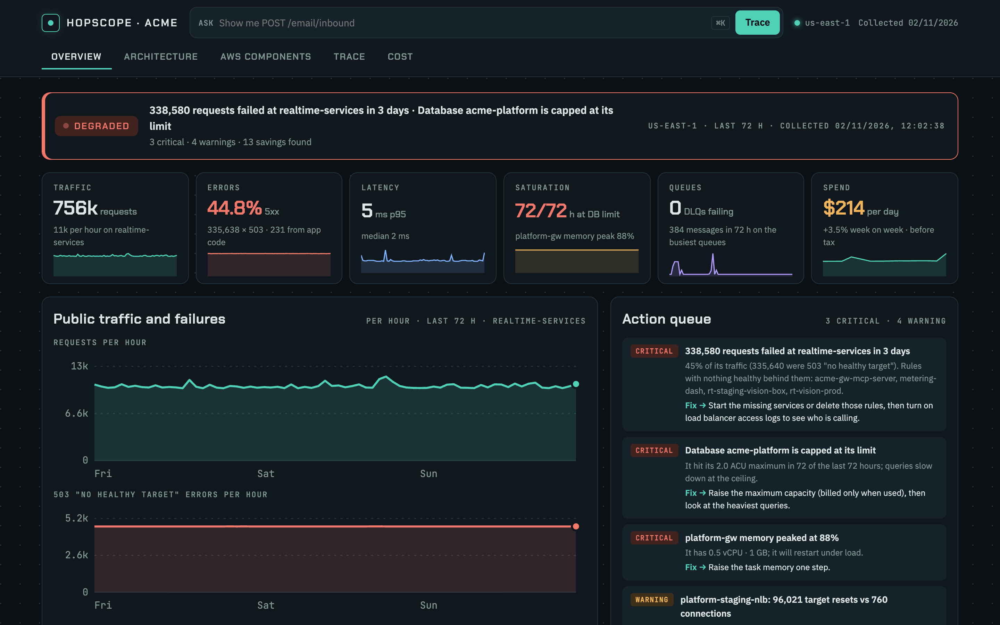
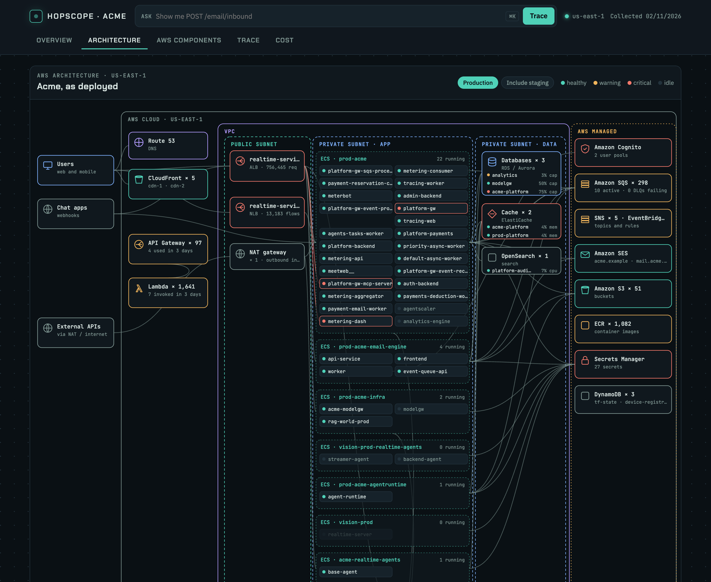
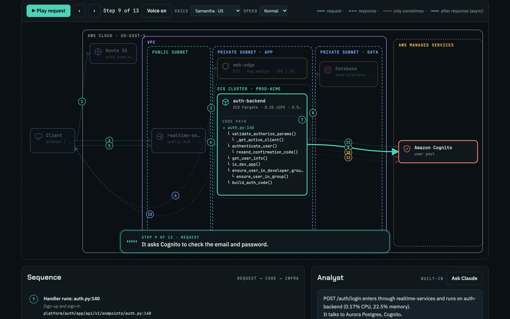
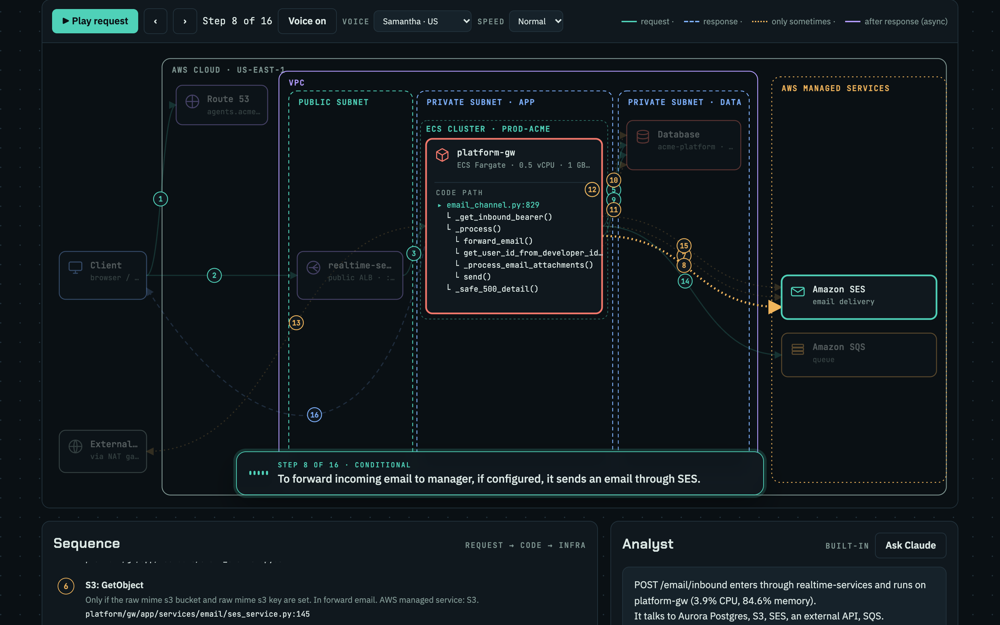
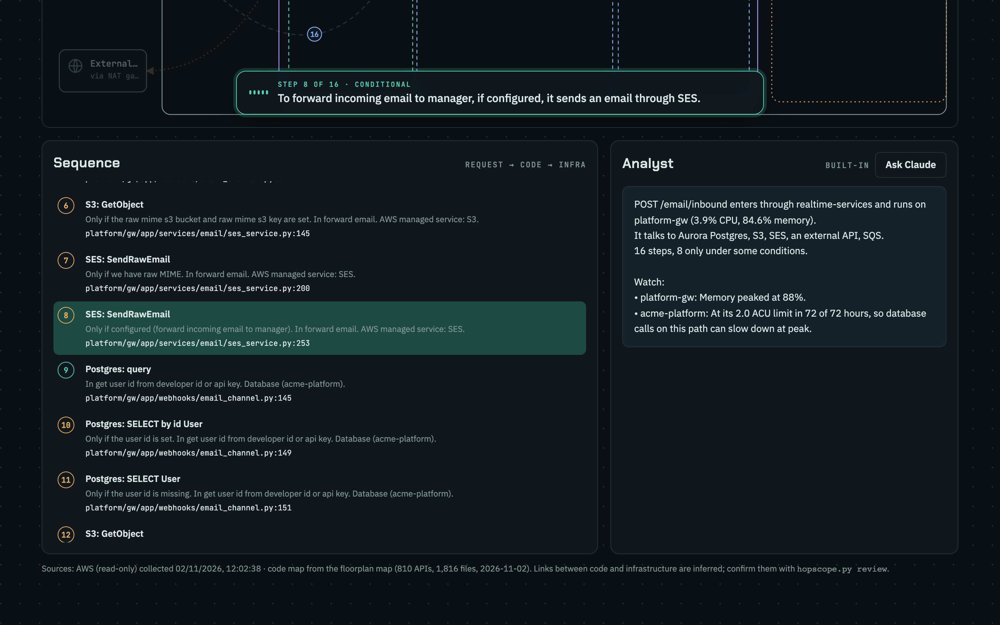
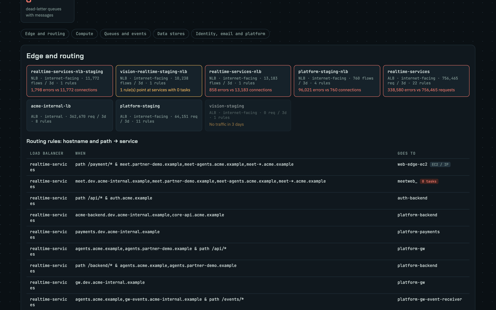
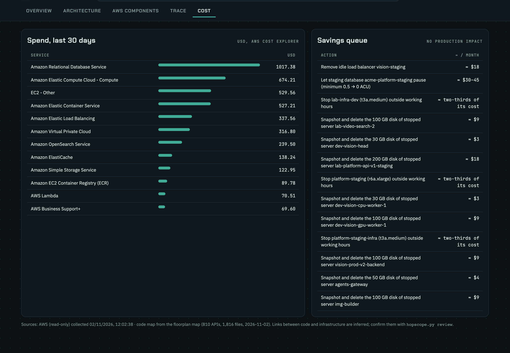
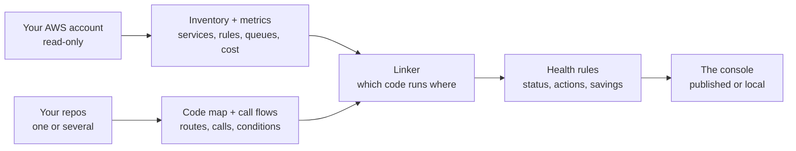

<div align="center">

<picture>
  <source media="(prefers-color-scheme: dark)" srcset="docs/images/logo-dark.png">
  
</picture>

**See where every request actually goes, on the AWS you really run.**

Hopscope reads your AWS account and your code, links the two, and gives you one page to run ops from. Ask for any API and watch it hop from the load balancer rule, through your code, to the databases and queues it touches.

[](https://code.claude.com/docs/en/overview)
[](https://github.com/supreeth-ravi/hopscope/actions/workflows/test.yml)
[](CHANGELOG.md)
[](LICENSE)
[](https://www.python.org)
[](skills/hopscope/references/iam-policy.json)

**[Try the live demo](https://supreeth-ravi.github.io/hopscope/demo/)** · [Install](#install) · [Quick start](#quick-start) · [Features](#features) · [See it in action](#see-it-in-action) · [How it works](#how-it-works) · [Docs](docs/README.md) · [FAQ](#faq)

</div>

<p align="center">
  
</p>
<p align="center"><sub>A sign-in request, hop by hop: DNS → load balancer rule → the server that serves the page → the <code>auth-backend</code> container and its code path → database and Cognito → back to the browser.</sub></p>
<p align="center"><b><a href="https://supreeth-ravi.github.io/hopscope/demo/">Try the live demo →</a></b> Explore Acme, a fictional company's console, in your browser. No install, no AWS account.</p>

## Why Hopscope?

Your system works, mostly. But ask "what actually happens when someone logs in?", "why are 40% of requests failing?" or "which of these 46 services can we turn off?" and the honest answer is a long afternoon of clicking through the AWS console and grepping code.

Metrics tools show graphs but don't know your code. Diagram tools draw your AWS but don't know your code either. Service catalogues are filled in by hand and drift. Hopscope joins the two automatically — **which code runs on which container, which queue it writes to, which worker reads it** — and asks a person only where the evidence is weak.

- **For on-call:** see what's broken, why, and the fix, before you open the AWS console.
- **For new engineers:** follow any request from the browser to the database and understand the system in an afternoon.
- **For whoever pays the bill:** find what's idle, oversized or forgotten, with an estimate for each.

## Features

<table>
<tr>
<td width="50%" valign="top">

**🩺 Health at a glance**<br>
One status, the four health signals for the last 72 hours, and an action queue: every problem with its impact and a concrete fix, worst first.

</td>
<td width="50%" valign="top">

**🗺️ Architecture, as deployed**<br>
A system-design diagram of what's really running — load balancers, ECS clusters, EC2, databases, caches, managed services — wired from your actual routing rules.

</td>
</tr>
<tr>
<td valign="top">

**🛰️ Trace any request**<br>
Ask for an API and see it hop through DNS, the load balancer rule, the container, the handler's code path, and every database, queue and service it calls.

</td>
<td valign="top">

**🧠 Explains the *why***<br>
Conditional steps say when they run, straight from the code: *"To forward incoming email to the manager, if configured, it sends an email through SES."*

</td>
</tr>
<tr>
<td valign="top">

**🔗 Code ↔ cloud, linked for you**<br>
Deployment files, names, container environment and queue names decide which code runs where. Every link shows its confidence and evidence; doubtful ones go to review.

</td>
<td valign="top">

**🧾 Every AWS component**<br>
Load balancer rules, Lambda, queues and dead-letter queues, topics, caches, search, buckets — with usage, idle families grouped, failures highlighted.

</td>
</tr>
<tr>
<td valign="top">

**💸 Cost and savings**<br>
30 days of spend by service and a savings list that never touches production: idle load balancers, disks on stopped servers, staging that never sleeps.

</td>
<td valign="top">

**🔒 Read-only and private**<br>
Only Describe/List/Get calls. Secrets are never stored, account numbers are masked, and the local server answers only to your machine.

</td>
</tr>
</table>

Plus a **voice narrator** for traces (your browser's voices, no delay), an **analyst** that summarises the risks on any path, and **staging/production** views.

## See it in action

<table>
<tr>
<td colspan="2">

<p><b>Overview.</b> 45% of public requests failing, the database pinned at its limit, a gateway at 88% memory — each with the fix.</p>
</td>
</tr>
<tr>
<td colspan="2">

<p><b>Architecture.</b> Every cluster and service with a live status dot, from real routing rules. Hover to trace connections.</p>
</td>
</tr>
<tr>
<td width="50%" valign="top">

<p><b>Trace.</b> The request on your infrastructure, with the handler's code path inside the container.</p>
</td>
<td width="50%" valign="top">

<p><b>Conditions, explained.</b> Steps that only sometimes run say when, from the developer's own comment.</p>
</td>
</tr>
<tr>
<td width="50%" valign="top">

<p><b>Sequence and analyst.</b> Every step with its file and line, and the risks on that path.</p>
</td>
<td width="50%" valign="top">

<p><b>Components.</b> Every routing rule from hostname and path to service; dead targets flagged.</p>
</td>
</tr>
<tr>
<td colspan="2">

<p><b>Cost.</b> Where the money goes, and what you can stop paying for without touching production.</p>
</td>
</tr>
</table>

<sub>Screenshots use the fictional demo company Acme: names, hosts and paths are replaced and traffic and cost are scaled.</sub>

## Install

You need [Claude Code](https://code.claude.com/docs/en/overview), Python 3.10+, and the AWS CLI signed in to your account (`aws login`).

```bash
claude plugin marketplace add supreeth-ravi/hopscope
claude plugin install hopscope@hopscope
```

Or inside a Claude Code session: `/plugin marketplace add supreeth-ravi/hopscope`, then `/plugin install hopscope@hopscope`.

## Quick start

1. Open Claude Code in the folder that holds your service repos.
2. Ask:
   > Build a Hopscope for our AWS account in eu-west-1 and these repos
3. Claude checks your AWS sign-in, collects (1–5 minutes), resolves the obvious code ↔ service links itself, asks you about the doubtful ones, and opens the console.

Prefer the command line? See [Getting started](docs/getting-started.md#without-claude).

### Things to try

| Ask Claude | Ask the console |
|---|---|
| "Build a Hopscope for our account in us-east-1" | "Show me POST /auth/login" |
| "Refresh Hopscope with today's numbers" | "How does a Slack message reach an agent?" |
| "What's the biggest risk in our AWS right now?" | "What happens on checkout?" |
| "Fix the critical items from Hopscope's action queue" | "Show me POST /orders" |
| "Which services in Hopscope can we turn off?" | Press ▶ and listen to the request |

## How it works



Python scripts do the collecting and linking; Claude runs them, checks the doubtful links with you, and explains the results. Details in [How it works](docs/how-it-works.md).

**AWS:** ECS (Fargate and EC2), EC2, Application and Network Load Balancers, API Gateway, CloudFront, RDS and Aurora, ElastiCache, OpenSearch, DynamoDB, S3, SQS, SNS, EventBridge, Lambda, Cognito, SES, ECR, Secrets Manager, Cost Explorer.<br>
**Code:** Python (FastAPI, Flask), JavaScript and TypeScript (Express, NestJS), Go. Call sequences with conditions for Python. Uses a [floorplan](https://github.com/haydenschmitty/floorplan) map when your repo has one.

## What it adds to your project

A `.hopscope/` folder with the collected data and the built page, and optionally a `hopscope.json` with your corrections. It never changes your code or your AWS resources.

## Privacy

- **Read-only AWS access.** Describe/List/Get calls, CloudWatch metrics and Cost Explorer only — the exact [IAM policy](skills/hopscope/references/iam-policy.json).
- **No secrets stored.** Container environment values are kept only when they are a queue URL or the bare hostname of a database, cache or search endpoint; account numbers are masked.
- **Stays on your machine** until you publish. Published pages in the Claude app are private until you share them. The local server only answers on localhost.
- No analytics or tracking.

More in [Security](SECURITY.md).

## Documentation

| | |
|---|---|
| [Getting started](docs/getting-started.md) | Install, first run, reviewing links, keeping it fresh, removing |
| [Using the console](docs/using-the-console.md) | Every view, the trace player, the analyst |
| [How it works](docs/how-it-works.md) | The pipeline, linking code to infrastructure, health rules |
| [Configuration](skills/hopscope/references/hopscope-json.md) | `hopscope.json`: corrections, labels, thresholds |
| [Troubleshooting](docs/troubleshooting.md) | Common problems and fixes |
| [Development](docs/development.md) | Repo layout, tests, the demo data |

## FAQ

<details>
<summary><b>Can it change anything in my AWS account?</b></summary>

No. Every call is a Describe, List or Get, plus CloudWatch metrics and Cost Explorer. The [IAM policy](skills/hopscope/references/iam-policy.json) contains no write permissions, so you can hand Hopscope a role that can't change anything.
</details>

<details>
<summary><b>Does my data leave my computer?</b></summary>

Only the way Claude Code always works: Claude reads the files it needs through your account. The collected data stays in `.hopscope/` on your machine. If you publish the console in the Claude app, the page and its data go to your private claude.ai account, and nothing is shared until you share it.
</details>

<details>
<summary><b>How does it know which code runs on which service?</b></summary>

It scores evidence: deployment files that name the service, name matches between services and folders, queue URLs and database endpoints in the container environment, and queue names in the code. Each link has a confidence; anything doubtful goes to `hopscope.py review`, and Claude asks you about it. Your answers live in `hopscope.json`. See [How it works](docs/how-it-works.md#link).
</details>

<details>
<summary><b>What does it cost to run?</b></summary>

A run makes a few hundred read API calls and CloudWatch metric queries, which usually costs cents, plus whatever Claude usage your plan already covers.
</details>

<details>
<summary><b>We use Kubernetes / GCP / Azure. Will it work?</b></summary>

Not yet. Hopscope covers ECS and EC2 on AWS today. EKS, several regions in one view, and other clouds are on the list.
</details>

<details>
<summary><b>Does it work with Codex?</b></summary>

The scripts are agent-agnostic, but the plugin packaging and the console's AI features target Claude Code today. Codex support is next.
</details>

## Contributing

Issues and pull requests are welcome. See [CONTRIBUTING.md](CONTRIBUTING.md) and [Development](docs/development.md).

## License

[MIT](LICENSE) © 2026 [Supreeth Ravi](https://supreethravi.com)
