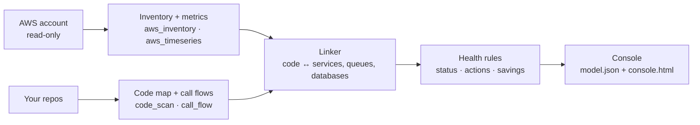

# How it works

## Collect

- **Inventory** (`aws_inventory.py`): ECS services with their task definitions, EC2, RDS/Aurora, load balancers with every listener rule and target health, SQS, SNS, Lambda, ElastiCache, OpenSearch, API Gateway, CloudFront, Cognito, S3, ECR, secrets, DynamoDB, SES, EventBridge, and 30 days of cost. Each comes with 3-day CloudWatch usage. Any collector that lacks permission is skipped with a warning.
- **Time series** (`aws_timeseries.py`): hourly series for the busiest public load balancer, the busiest production database, the production container closest to its memory limit and the three busiest queues, plus 14 days of daily cost.

## Read the code

- **Code map** (`code_scan.py`): services (folders with a Dockerfile or package manifest), files, imports, API routes (FastAPI, Flask, Express, NestJS, Go), router prefixes across files, and which external systems each file talks to. An existing floorplan map is used instead when present, for its human-readable names.
- **Call flows** (`call_flow.py`): for every Python handler, the calls in source order, followed into your own functions, recording each call that leaves the process: SQL with table names, AWS SDK calls, cache, queues, HTTP to other services, model calls. Each step records whether it always runs, runs under a condition (and which one), or only on error.

## Link

`linker.py` decides which code folder runs on which ECS service, using:

1. **Deployment files** — Dockerfiles, CI workflows, task definitions, Terraform — that name a service, counted only for the folder they live in or a path named next to the service.
2. **Names** — service and image names against folder names, weighting rare words over common ones and ignoring prefixes shared by most clusters.
3. **Container environment** — queue URLs and database endpoints.
4. **Queue names** found in the code.

Each link has a confidence and its evidence. Below 0.6, or a near-tie between two folders, it goes to `hopscope.py review`. Services running public images are treated as off-the-shelf software. `hopscope.json` overrides anything.

## Design mode

`hopscope.py design` replaces the AWS collector with readers for infrastructure files. `iac_compose.py`, `iac_terraform.py` and `iac_cfn.py` turn docker compose, Terraform and CloudFormation/SAM into the same `aws.json` layout the collector writes, marked `"mode": "design"`: metrics are zero, and a planned task count stands in for running tasks. `iac_scan.py` finds the files under the repos, runs the readers (all `.tf` files in a folder are read together) and merges the rows. Files that cannot be read are skipped and listed.

- **Exact placement.** A compose `build:` folder says which code builds a service, so the linker places it with confidence 1.0 instead of guessing from names. All queues in the files count as queues (there is no traffic to filter by), but a queue is linked to code only through a real reference: a quoted name, the tail of a queue URL, or an environment variable named like `ORDERS_QUEUE`.
- **Environment values are allowlisted.** Only queue names and URLs, masked AWS hosts, the bare host of a URL, resource names under keys that name a resource, and short service names under host keys are kept. Everything else, credentials above all, is dropped before anything is stored.
- **Design checks.** `rules.py` runs checks that need no metrics: routes whose target group has nothing in the files serving it, queues with no dead-letter queue, production services planned with a single task, and services with no code found.
- **Console.** The Overview, Architecture, Components and Trace views show what is planned ("planned 2 tasks", "defined") and never a measured-looking number; the Cost tab is hidden.

Not read yet: the Serverless Framework, CDK (unless `cdk synth` output is in the repo), Kubernetes and Helm, and Pulumi. Terraform modules, variables, `for_each` and expressions are not evaluated; values that depend on them are left out rather than guessed.

## Rules

`rules.py` turns everything into a status, an action queue and savings: failing load balancer traffic and dead routes, databases at their capacity limit, containers near their memory limit, dead-letter queues with messages, backed-up queues, single-task production services, single EC2 servers carrying a large share of traffic, burstable instances paying for surplus credits, idle staging, disks on stopped servers, idle load balancers, unattached IPs and image-repository sprawl. Thresholds are configurable.
