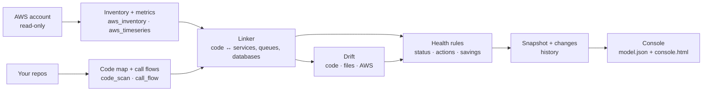

# How it works

## Collect

- **Inventory** (`aws_inventory.py`): ECS services with their task definitions, EC2, RDS/Aurora, load balancers with every listener rule and target health, SQS, SNS, Lambda, ElastiCache, OpenSearch, API Gateway, CloudFront, Cognito, S3, ECR, secrets, DynamoDB, SES, EventBridge, and 30 days of cost. Each comes with 3-day CloudWatch usage. Any collector that lacks permission is skipped with a warning.
- **Time series** (`aws_timeseries.py`): hourly series for the busiest public load balancer, the busiest production database, the production container closest to its memory limit and the three busiest queues, plus 14 days of daily cost.

## Read the code

- **Code map** (`code_scan.py`): services (folders with a Dockerfile or package manifest), files, imports, API routes (FastAPI, Flask, Express, NestJS, Go), router prefixes across files, and which external systems each file talks to. An existing floorplan map is used instead when present, for its human-readable names.
- **Call flows** (`call_flow.py`): for every Python handler, the calls in source order, followed into your own functions, recording each call that leaves the process: SQL with table names, AWS SDK calls, cache, queues, HTTP to other services, model calls. Each step records whether it always runs, runs under a condition (and which one), or only on error.

## Link

`linker.py` decides which code folder runs on which ECS service, using:

1. **Deployment files** — Dockerfiles, CI workflows, task definitions, Terraform — that name a service, counted only for the folder they live in or a path named next to the service.
2. **Names** — service and image names against folder names, weighting rare words over common ones and ignoring prefixes shared by most clusters.
3. **Container environment** — queue URLs and database endpoints.
4. **Queue names** found in the code.

Each link has a confidence and its evidence. Below 0.6, or a near-tie between two folders, it goes to `hopscope.py review`. Every answer that says which compute runs which code (traces, `impact`, `what_runs`, `health`, drift findings that rest on a link, the console drawer and trace) marks a link below 0.6 as unconfirmed, with its confidence. Services running public images are treated as off-the-shelf software. `hopscope.json` overrides anything.

## Design mode

`hopscope.py design` replaces the AWS collector with readers for infrastructure files. `iac_compose.py`, `iac_terraform.py` and `iac_cfn.py` turn docker compose, Terraform and CloudFormation/SAM into the same `aws.json` layout the collector writes, marked `"mode": "design"`: metrics are zero, and a planned task count stands in for running tasks. `iac_scan.py` finds the files under the repos, runs the readers (all `.tf` files in a folder are read together) and merges the rows. Files that cannot be read are skipped and listed.

- **Exact placement.** A compose `build:` folder says which code builds a service, so the linker places it with confidence 1.0 instead of guessing from names. All queues in the files count as queues (there is no traffic to filter by), but a queue is linked to code only through a real reference: a quoted name, the tail of a queue URL, or an environment variable named like `ORDERS_QUEUE`.
- **Environment values are allowlisted.** Only queue names and URLs, masked AWS hosts, the bare host of a URL, resource names under keys that name a resource, and short service names under host keys are kept. Everything else, credentials above all, is dropped before anything is stored.
- **Design checks.** `rules.py` runs checks that need no metrics: routes whose target group has nothing in the files serving it, queues with no dead-letter queue, production services planned with a single task, and services with no code found.
- **Console.** The Overview, Architecture, Components and Trace views show what is planned ("planned 2 tasks", "defined") and never a measured-looking number; the Cost tab is hidden.

Not read yet: the Serverless Framework, CDK (unless `cdk synth` output is in the repo), Kubernetes and Helm, and Pulumi. Terraform modules, variables, `for_each` and expressions are not evaluated; values that depend on them are left out rather than guessed.

## Asking the build (MCP, CLI, exports)

`hopscope_query.py` answers questions from the files a build leaves in `<workdir>/data` (or `site/`): `code.json`, `flows.json`, `model.json`, `aws.json`, and `links.json`, `changes.json` and `drift.json` when present (`hopscope_changes.py` answers the last two). It is standard-library only, never calls AWS, starts processes or writes files, caps every string at 300 characters and every list at 50 items, and gives the same answer for the same data.

`hopscope_mcp.py` serves those answers to agents as an MCP server over stdio (newline-delimited JSON-RPC 2.0, protocol revision 2025-06-18; 2025-03-26 and 2024-11-05 clients get their own version back). The Claude Code plugin registers it in `.claude-plugin/plugin.json`, pointed at `${CLAUDE_PROJECT_DIR}/.hopscope`; it reads the data again on every call, so a rebuild needs no restart. Missing data, unknown files and bad arguments come back as tool errors (`isError: true`), never a crash.

| Tool | Arguments | Answers |
|---|---|---|
| `find_routes` | `query`, `limit` | Routes matching a method, path or title words, best first |
| `trace` | `route` | The load balancer rule, the compute, each code-path step (file:line, kind, condition), and the queues, workers and database reached |
| `who_calls` | `target` (file or function), `depth` | Files that import or call it, transitively (import, HTTP and queue edges), and the routes that reach it |
| `what_runs` | `code_folder` | Compute, queues (publishes or consumes, with workers), database and route count for a code folder |
| `impact` | `path` | Dependent files; routes whose handler or code path reaches the file or a dependent, nearest first; their services and compute; queues they publish to and the workers consuming them |
| `resources` | `kind` | Infrastructure rows with status and notes, and a count of each AWS component type |
| `health` | `name` | A resource's status and note, the action-queue items that mention it; in design mode, a note that there are no live numbers |
| `changes` | `since` | What changed since the previous build (or a named snapshot), one line per change, earlier builds' summaries, and recent ECS deploys and revisions |
| `drift` | `kind` | Drift findings with evidence and confidence, what was checked and skipped, and unsure matches |

A route's queues come from its own publishing steps: a step that names its queue is matched exactly; when it doesn't (the usual case today), the queues its service publishes to stand in, marked `"basis": "service publishes to"`. File targets may be repo-relative, a tail (`app/db.py`), an absolute or Windows path ending in a mapped file, or a folder.

`impact` follows code-map edges backwards (up to 6 hops) and call-flow steps, so its reach is limited by the code map: call sequences exist for Python handlers only, and a dynamic import the scanner can't see is not followed.

`hopscope.py impact <file>` and `hopscope.py query "<METHOD /path>"` print the same answers as text. `hopscope.py export` writes a Mermaid flowchart of the architecture (load balancers, the services behind them, data stores and queues, then workers and services nothing routes to), a Mermaid sequence diagram of one route (`--route`), or a draw.io file of the architecture with AWS resource icons (`mxgraph.aws4`) in the same four columns. Labels come from code and accounts, so exports drop control characters, cap lengths, escape Mermaid syntax characters as entity codes and write draw.io labels as plain text through an XML serialiser.

## History and deploys

`history.py` runs after the health rules on every `all`, `collect` and `design`. It copies `aws.json`, `links.json` and `model.json` into `<workdir>/snapshots/<UTC time>/` (named from the inventory's collection time) and stores only the hash and counts of `code.json` and `flows.json`, which can be large. It then diffs the new snapshot against the previous one and writes `data/changes.json`: resources added and removed, fields that changed (desired and running counts, sizes, images, task-definition revision, target groups, load balancer rules, queue settings, database class and capacity, Lambda memory), links whose code folder moved or whose confidence changed by 0.1 or more, and action-queue items that appeared or resolved (numbers in titles are ignored when matching). Each snapshot keeps its own `diff.json`, so `changes.json` also carries the last ten builds' summaries. The last 30 snapshots are kept (`--keep`). `hopscope.py changes --since <snapshot>` diffs any kept snapshot against the latest. If this step fails, the build warns and carries on without `changes.json`.

In live mode the ECS collector records, per service, the task-definition revision and when it was registered, the `deployments[]` (status, rollout state, task definition, created and updated times) and the last 20 `events` from the DescribeServices call it already makes (the repeated "has reached a steady state" events are only counted, as `steadyEvents`), and up to five revisions of the family (one `ListTaskDefinitions` and a `DescribeTaskDefinition` per earlier revision, at most 200 per run). ARNs in event messages are reduced to names, AWS endpoints masked, IP addresses and EC2 host names replaced, and account numbers masked. ECS forgets a deployment once a newer one finishes, so older deploys appear as revisions (registration time), not deployments.

`rules.py` adds one action when a deployment or new revision came in the three hours before the first hour whose 5xx count is at least five times the usual (median) level, and up to three for services whose events in the last 72 hours say tasks could not start: no capacity to place them, an image that could not be pulled, or failed container or load balancer health checks ("shop-api couldn't start tasks 3 times: load balancer health checks failed").

A snapshot never goes back in time: a build whose collection time is not after the latest snapshot's is stamped one second after it, and pruning never removes the snapshot just written. A switch between live and design mode, or an unreadable earlier snapshot, gives a one-line note instead of a diff.

## Drift

`drift.py` compares up to three sources: the code (`code.json`, `links.json`), the infrastructure files (`iac_scan.py` also runs in live mode and writes `data/iac.json` when the repos have compose, Terraform or CloudFormation files; in design mode `aws.json` is the files) and the live account (`aws.json` in live mode). If it fails, the build warns and carries on without `drift.json`.

- **Matching AWS to the files.** A resource and a file row are the same only when their names are equal once environment words and plain numbers are ignored (`staging-kestrel-orders.fifo` = `kestrel-orders.fifo`, `kestrel-cache-001` = `kestrel-cache`), when the file's name was built from a Terraform variable (`${var.env}-orders`) and the AWS name ends with what is left, or, for ECS, when the links place the service on the code folder the file row builds. Names that only share words (`staff-backend` and `backend`) are not matched and never produce a difference; `drift.py --similar` lists them under "uncertain". Among same-named rows, the one in the same environment and cluster is used.
- **AWS against files:** ECS services, queues, databases, Lambdas, caches and load balancers in AWS with no file defining them (only for kinds the non-compose files define at all; compose is usually local development), and resources in the files that aren't deployed. For matched ECS services: a literal desired count that differs, image repositories that differ (images built from variables are not compared), and a different task-definition family. When the links place a service on folder A but the file row with its name builds folder B, the finding is "the link may be wrong": it is usually the linker's guess, fixed in `hopscope.json`.
- **Code against AWS (or the files in design mode):** queues no code, container setting or link references (a per-tenant family counts as referenced when the code contains its static prefix, such as `tenant_events_` in an f-string); quoted `.fifo` names and SQS URLs in the code that don't exist (only when the account has SQS queues, or the files define some; `ORDERS_QUEUE = "jobs"` style names may belong to Celery, Redis or RabbitMQ and are not reported); container settings pointing at a queue or database that doesn't exist. In design mode such a resource may be defined in another repo or created outside infrastructure files, so the finding says so; when a scanned file names it, it is informational only and not counted as a broken setting. Likewise a queue the code names that the files don't define is informational in design mode (it may be defined in another repo or created at runtime). Tests, fixtures and docs are not read.
- **Grouping.** Per-tenant families (`tenant_events_*.fifo`) are one finding each, and the other resources of a kind are one finding, with a count and up to five names. Findings are ordered: links that may be wrong and image or count differences first, then broken references, then what isn't deployed, then what is in no file, then unused queues.

`rules.py` turns the report into at most three action-queue items, with grouped counts ("In AWS but in no infrastructure file: 1 queue family (14 queues), 1 ECS service, 1 database").

## Rules

`rules.py` turns everything into a status, an action queue and savings: failing load balancer traffic and dead routes, databases at their capacity limit, containers near their memory limit, dead-letter queues with messages, backed-up queues, single-task production services, single EC2 servers carrying a large share of traffic, burstable instances paying for surplus credits, idle staging, disks on stopped servers, idle load balancers, unattached IPs and image-repository sprawl. Thresholds are configurable.
