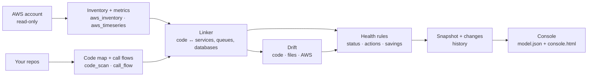

# How it works

## Collect

- **Inventory** (`aws_inventory.py`): ECS services with their task definitions, EC2, RDS/Aurora, load balancers with every listener rule and target health, SQS, SNS, Lambda, ElastiCache, OpenSearch, API Gateway, CloudFront, Cognito, S3, ECR, secrets, DynamoDB, SES, EventBridge, and 30 days of cost. Each comes with 3-day CloudWatch usage. Any collector that lacks permission is skipped with a warning.
- **Workflows and streams** (`aws_streams.py`): Step Functions state machines, with the services their definition calls (Lambda, SQS, SNS, DynamoDB, ECS RunTask, nested state machines; Parallel branches and Map processors included) and executions started and failed in 72 hours; Kinesis streams with incoming records and iterator age; MSK clusters (topics are not read); the targets of each EventBridge rule; and Lambda event source mappings, which say which function reads which queue, stream, table stream or Kafka topic. A definition is parsed for its integrations and dropped, every ARN becomes a name, and self-managed Kafka broker addresses are never stored.
- **EKS and Kubernetes** (`aws_eks.py`): EKS clusters and node groups (no endpoints, ARNs or roles). With `--kube-context <ctx>` (or `--kube-contexts a,b`), `kubectl --context <ctx> get deploy,sts,ds,svc,ing,hpa,cronjob -A -o json` and `kubectl get events -A -o json` run as list-form subprocesses with a timeout, no shell and only the `get` verb (never Secrets; refused when kubectl is missing). The objects go through the same mapper as design mode (`k8s_map.py`), with ready replicas as the running count. Warning events from the last 72 hours become event rows on the workload they concern (a pod is matched to its workload by name), masked like ECS events, and CrashLoopBackOff, ImagePullBackOff, FailedScheduling and OOMKilled count as tasks that could not start. With several contexts each namespace is shown as `<context>:<namespace>`. Kubernetes rows have no CloudWatch metrics, so CPU, memory and idle-load-balancer rules skip them.
- **Time series** (`aws_timeseries.py`): hourly series for the busiest public load balancer, the busiest production database, the production container closest to its memory limit and the three busiest queues, plus 14 days of daily cost.
- **Several regions and accounts** (`aws_multi.py`, `aws_accounts.py`, `aws_merge.py`). `--region a,b,c` or `--all-regions` (the regions `ec2:DescribeRegions` lists as enabled for each account), and `--profile p1,p2` (one account per profile) or, opt-in, `--org-role <RoleName>`: the signed-in management or delegated administrator account lists the organization's active accounts (`organizations:ListAccounts`, `--accounts id1,id2` to limit) and assumes `arn:<partition>:iam::<id>:role/<RoleName>` in each (`sts:AssumeRole`, session name `hopscope`, one hour, with an inline session policy of only the read actions in `iam-policy.json`). Each account and region runs the same read-only collectors and time series, four at a time; a region where nothing is found is left out, and a region or account that fails (no role, no permission, a disabled region) is skipped with a warning that names only its label, and a region where every collector failed says so rather than "nothing found"; if nothing at all could be read, the run stops with the reasons. kubectl contexts are scopes of their own (`kube:<context>`). CloudFront, the S3 bucket count and Cost Explorer are read once per account. The results merge into one `aws.json` and `ts.json`: every row carries `region` and `account`; an account is its alias (`iam:ListAccountAliases`) or `acct-••••1234`, and its number is never written. A name that two scopes share gets a scope prefix in both (`eu-west-1:orders`, `kestrel-prod:orders`, or both), and every reference follows it (load balancer routes, target groups, event source mappings, EventBridge and Step Functions targets, time-series labels); names nobody else uses stay as they are. Traffic and errors add up across regions, latency is the worst of any, and the most saturated database, the container closest to its memory limit and the three busiest queues are charted. The linker, streams, drift and the model match on the plain name, and a queue URL in a service's settings means the queue in its own region and account. A plain `cluster/service` key in `hopscope.json` (placement, `null`, `queueWorkers` by queue name) covers every region's copy, a prefixed key names one, and a key that names no service is reported. History keys resources by kind, account, region and plain name, so a skipped region shows as its own resources removed and nothing else. Hourly series are aligned on the latest start hour before they are added up. One region with one profile keeps the single-scope steps.

## Read the code

- **Code map** (`code_scan.py`): services (folders with a Dockerfile or package manifest: `pyproject.toml`, `package.json`, `go.mod`, `pom.xml`, `build.gradle`, a `.csproj`, `Gemfile`, `composer.json`, `Cargo.toml`), files, imports, API routes, router prefixes across files, and which external systems each file talks to. Each language is a module in `scripts/langs/` (the plugin interface is in [Development](development.md#adding-a-language)):
  - **Python:** FastAPI, Flask; imports resolved to files; `include_router`/`register_blueprint` prefixes.
  - **JavaScript / TypeScript:** Express-style routers, NestJS controllers; relative imports.
  - **Go:** gin/echo/chi-style routes, `net/http` handlers and gorilla/mux `HandleFunc(prefix+"/x", h).Methods(...)` (one route per method; a prefix variable is resolved when the file only ever assigns it one string literal, else the route starts with `{?}` and is never matched to a frontend call).
  - **Java / Kotlin:** Spring MVC and Spring Boot (`@RestController`/`@Controller` with class and method mappings, `@RequestMapping(method = …)`), Micronaut, JAX-RS and Ktor `routing { }` blocks; controllers that implement interfaces generated from an OpenAPI spec take their routes from the spec's `operationId`s. Imports resolve through `package` declarations (explicit, wildcard and same-package types the file names). Externals: JDBC/JPA/Spring Data (the database from the build files), Redis, the AWS SDK v1/v2 (SQS, SES, S3, Cognito), OpenSearch/Elasticsearch, Kafka, and HTTP clients (RestTemplate, WebClient, Feign).
  - **C# / ASP.NET Core:** attribute-routed controllers (`[Route("api/[controller]")]` with `[HttpGet("{id}")]`, the `[controller]` and `[action]` tokens, routes inherited from a base controller) and minimal APIs (`app.MapGet`, `MapGroup` prefixes). Imports resolve through namespaces and `using`. Externals: EF Core, SqlClient and Npgsql (`postgres` or `mssql`), StackExchange.Redis, AWSSDK (SQS, SES, S3, Cognito), Confluent.Kafka and MassTransit riders, HttpClient. The service is the folder of the `.csproj`.
  - **Ruby:** Rails `config/routes.rb` read without running it: `resources`/`resource` (only/except, `param:`, nesting, `member`/`collection` blocks and `on:`), `namespace`/`scope` (path and module), verb routes (`get 'p' => 'c#a'`, `to:`), `match … via:`, `root`, and the sign-in/sign-out/sign-up routes of `devise_for`; each route points at its controller action (`app/controllers/<ns>/<name>_controller.rb`, the `def` line). Resource routes follow Rails (form routes unless `only`/`except` drop them; update as both PATCH and PUT). Sinatra and Grape route blocks with `namespace`/`resource`/`route_param` nesting and Grape's `prefix` and path `version`. Imports through `require_relative`, `require` of `lib/` files and Rails autoloading (a constant names its file). Externals: ActiveRecord (the database from the Gemfile: `pg` → postgres, `mysql2`/`trilogy` → mysql; sqlite3 alone draws none), Redis and `Rails.cache`, the AWS SDK (SQS, SES, S3, Step Functions, Kinesis), Kafka (ruby-kafka, rdkafka, Karafka/WaterDrop) and HTTP clients. The service is the folder of the `Gemfile`.
  - **PHP:** Laravel route files (`Route::get/post/…/match/any/view`, `resource`/`apiResource` with only/except, `Route::prefix('x')->group(…)` and `Route::group(['prefix' => 'x'], …)`, `/api` for `routes/api.php`, `[Controller::class, 'm']` and `'Controller@m'` targets resolved to the controller method), Symfony `#[Route]` attributes and `@Route` annotations with a class-level prefix, and Slim/Lumen `$app->get()` with groups. Imports through `use` and namespaces, falling back to composer.json's PSR-4 map, and literal `require`/`include` paths. Externals: Eloquent, the DB facade, Doctrine and PDO (the database from `config/database.php`'s default connection or composer.json; `.env` is never read), Cache/Redis/Predis, the AWS SDK (SqsClient, SesClient, S3Client, SfnClient, KinesisClient), Kafka and HTTP clients (Http facade, Guzzle). Files that only return a config array get no externals. The service is the folder of `composer.json`.
  - **Rust:** axum `Router::new().route("/x", get(h).post(h2))` with `.nest("/p", …)` (an inline router, a local `let` router, or a fn returning one, also in another module's file), actix-web `.route`, `web::resource(…).route(web::get().to(h))` and `web::scope`, Rocket `mount("/p", routes![…])`, and the `#[get("/x")]` macros of actix-web and Rocket under the scope or mount that registers them; routes point at their handler fn. Imports through `mod x;`, `use crate::a::b` and module-qualified paths (`src/a/b.rs` or `src/a/b/mod.rs`). Externals: sqlx, diesel and sea-orm (postgres or mysql from the code or Cargo.toml), redis, the AWS SDK crates, rdkafka and reqwest. The service is the folder of `Cargo.toml`; `target/` is skipped.

  Every language also detects Step Functions (`sfn`), Kinesis (`kinesis`) and Kafka (`kafka`) clients.

  An existing floorplan map is used instead when present, for its human-readable names.
- **Frontend calls** (`code.json` `clientCalls`): in JavaScript/TypeScript frontends (a service whose `package.json` names React, Vue, Svelte, Next, Nuxt or Angular and no server framework such as Express, Fastify, Koa, Nest, Hono, next-connect, h3, Elysia, Polka or tRPC, or folders named `frontend`, `web`, `ui`, `client`, `admin_frontend`; a route-less Node worker is not a frontend). `api.get('/x', handler)` with a handler as its second argument is always a route., the HTTP calls: `fetch`, `axios` and axios instances, Angular `HttpClient`, `useSWR`/`useFetch`. The URL is rebuilt from literals, template literals, `+` and the file's own constants; a leading base named like our own backend (`API_URL`, `API_BASE`, `BASE_URL`, `BACKEND…`, e.g. `environment.REST_API_URL`) is dropped, and any other leading variable only when an `/api` segment follows it (`STRIPE_URL` is someone else's) and other variables become `{param}`. A variable glued to the end of the last segment (`/agents${qs}`) and anything after `?` are a query string and are dropped; only a variable forming a whole segment is a parameter. axios/ky instances (`axios.create({ baseURL })`) and fetch wrappers (`apiFetch(path)` calling `fetch(`${API}/api/v1${path}`)`), in the file or imported from a relative module, prefix their calls with the literal path of their base. Each call is matched to a backend route by method and path, ignoring case and tolerating a different `/api`, `/api/v1` or `/rest` prefix (a segment containing `{…}`, such as `v{version:apiVersion}`, is a parameter); failing that, the single same-method route whose path ends with the call's path (two segments or more) after a plausible prefix (`/api`, `/api/v1`, `/<word>`) matches; a frontend whose path doesn't mention admin reaches an `/admin` route this way only with a tail of three segments or more, with `"suffix"` as a sixth item. Rows are `[file, line, method, path, route index or null]` (+ `"suffix"`); calls to other hosts and static files are skipped. Express `app.use('/prefix', router)` prefixes the mounted router's routes.
- **Call flows** (`call_flow.py`): for every Python handler, the calls in source order, followed into your own functions, recording each call that leaves the process: SQL with table names, AWS SDK calls, cache, queues, HTTP to other services, model calls. Each step records whether it always runs, runs under a condition (and which one), or only on error. Java, Kotlin and C# handlers get the same steps from `langs/braceflow.py`, which reads the handler's body with brace matching (no parser): calls through injected fields, parameters and locals are followed into the service's own classes up to three levels (an interface resolves to the class implementing it), and repository and DbContext calls (sql, with the entity), AWS SDK clients, HTTP clients, Redis and Kafka producers are recorded; calls inside `if`/`else`/`switch`/`when` are conditional and inside `catch` on error. Ruby, PHP and Rust handlers get the same steps from `langs/scriptflow.py` (Ruby methods found by matching `def`/`do`/`if` … `end`, PHP and Rust by brace matching): the service's own functions are followed one level deep, and ActiveRecord/Eloquent/Doctrine calls (sql, with the model), sqlx/diesel queries (the table named in the SQL), the DB facade, Redis, AWS SDK, Kafka and HTTP calls are recorded; `if`/`unless`/`case`/`match` are conditional, `rescue`, `catch` and `Err(_) =>` on error. It is deliberately modest: reflection, dependency injection by name, MediatR-style dispatch, actor messages and lambdas passed elsewhere are not followed.

## Observed traffic (browser captures)

`hopscope.py observe --har file.har [--har …] [--include-host h]` (`observe_har.py`) reads HAR files exported from the browser with the standard library. It keeps requests to the captured page's host, to `--include-host` hosts, and to any host that served requests matching at least two different scanned routes (an API on another domain needs `--include-host` otherwise); files over 100 MB are refused; static files (scripts, styles, images, fonts, page loads that match no route), CORS preflights and other sites are counted and dropped. Each path keeps only segments that are plain lowercase words or literal segments of a scanned route; every other segment (ids, tokens, names, mixed case) becomes `{id}`. The request is matched to a route with the frontend-call matcher. `data/observed.json` holds, per route, the request count, status classes (2xx/3xx/4xx/5xx/failed), average time and last time seen, and the request patterns no route serves (at most 50). Headers, cookies, query strings, bodies, hosts and full URLs are never stored. `trace` (CLI, MCP, console) says "seen in a browser capture (N requests: …)", matching rows by route name so a rebuild that renumbers routes keeps them, and the MCP `observed` tool lists what was seen and what no route serves.

## Link

`linker.py` decides which code folder runs on which ECS service, using:

1. **Deployment files** — Dockerfiles, CI workflows, task definitions, Terraform — that name a service, counted only for the folder they live in or a path named next to the service.
2. **Names** — service and image names against folder names, weighting rare words over common ones and ignoring prefixes shared by most clusters.
3. **Container environment** — queue URLs and database endpoints.
4. **Queue names** found in the code.

Kubernetes workloads link like ECS services. `linker_lambda.py` places a code folder on the Lambda functions whose names are exactly the folder's name words plus the prefix most functions share and environment words (`kestrel-orders-api` runs `orders-api`; `shop-api-warmer` runs nothing), unless the folder already runs on ECS or Kubernetes; `hopscope.json` `placement` entries named `lambda:<function>` set or (with `null`) remove one. Linked functions become model rows of kind `lambda`, so a route traces client → API Gateway (the busiest one in the function's region) → the function → what its code calls. `linker_streams.py` also ties a code folder to the Kinesis streams, state machines and Kafka topics (those a Lambda event source reads) that a file using that kind of client names as a quoted string or ARN tail, or that a placed service's settings name, and lists each queue's, stream's and topic's Lambda consumers (`links.json` `streams` and `consumers`); a trace then shows the streams and workflows a route reaches, who consumes them and what a state machine calls.

Each link has a confidence and its evidence. Below 0.6, or a near-tie between two folders, it goes to `hopscope.py review`. Every answer that says which compute runs which code (traces, `impact`, `what_runs`, `health`, drift findings that rest on a link, the console drawer and trace) marks a link below 0.6 as unconfirmed, with its confidence. Services running public images are treated as off-the-shelf software. `hopscope.json` overrides anything.

## Design mode

`hopscope.py design` replaces the AWS collector with readers for infrastructure files. `iac_compose.py`, `iac_terraform.py` and `iac_cfn.py` turn docker compose, Terraform and CloudFormation/SAM into the same `aws.json` layout the collector writes, marked `"mode": "design"`: metrics are zero, and a planned task count stands in for running tasks. `iac_scan.py` finds the files under the repos, runs the readers (all `.tf` files in a folder are read together) and merges the rows. Files that cannot be read are skipped and listed.

- **Exact placement.** A compose `build:` folder says which code builds a service, so the linker places it with confidence 1.0 instead of guessing from names. All queues in the files count as queues (there is no traffic to filter by), but a queue is linked to code only through a real reference: a quoted name, the tail of a queue URL, or an environment variable named like `ORDERS_QUEUE`.
- **Environment values are allowlisted.** Only queue names and URLs, masked AWS hosts, the bare host of a URL, resource names under keys that name a resource, and short service names under host keys are kept. Everything else, credentials above all, is dropped before anything is stored.
- **Design checks.** `rules.py` runs checks that need no metrics: routes whose target group has nothing in the files serving it, queues with no dead-letter queue, production services planned with a single task, and services with no code found.
- **Console.** The Overview, Architecture, Components and Trace views show what is planned ("planned 2 tasks", "defined") and never a measured-looking number; the Cost tab is hidden.

**Kubernetes** (`iac_k8s.py`, `iac_kustomize.py`, `iac_helm.py`, `k8s_map.py`). Plain manifests (multi-document YAML) give Deployments, StatefulSets, DaemonSets, CronJobs and Jobs as service rows (cluster = namespace, or `k8s`; desired = replicas, or the HPA minimum; images by repository name; env values and ConfigMap values through the same allowlist, never Secrets), database, cache and search images as data rows, and Services, Ingresses (with their IngressClass) and Gateway API HTTPRoutes as load balancer rows whose routes reach the workloads their selectors pick; an HPA adds its min and max. Kustomize is read as written: `resources`/`bases`/`components` inside the repo (remote bases are listed as skipped), `configMapGenerator` literals, strategic-merge patches by kind and name, `images`, `replicas`, then `namePrefix`/`nameSuffix` (references follow) and `namespace`; only overlays are rendered, not the bases they use. Helm charts are read without helm: only `{{ .Values.a.b }}` with a plain value, `{{ .Release.Name }}`, `{{ include "x.fullname" . }}`, `.Chart.Name`, `.Chart.Version` and `.Chart.AppVersion` are filled in, and a line with any other template logic is left out; a chart with a `rendered/` or `manifests/` folder is not templated. The same object found in several places is read once, preferring pre-rendered output, then Kustomize overlays, then plain manifests, then Helm. Images are tied to code exactly by `skaffold.yaml` artifacts, then compose `build` folders, then a Dockerfile folder named like the image. Files are read only inside the repo, never through a symlink, at most 1 MB each.

Not read yet: the Serverless Framework, CDK (unless `cdk synth` output is in the repo), Pulumi, Helm template logic beyond simple values, and remote Kustomize bases. Terraform modules, variables, `for_each` and expressions are not evaluated; values that depend on them are left out rather than guessed.

## Asking the build (MCP, CLI, exports)

`hopscope_query.py` answers questions from the files a build leaves in `<workdir>/data` (or `site/`): `code.json`, `flows.json`, `model.json`, `aws.json`, and `links.json`, `changes.json` and `drift.json` when present (`hopscope_changes.py` answers the last two). It is standard-library only, never calls AWS, starts processes or writes files, caps every string at 300 characters and every list at 50 items, and gives the same answer for the same data.

`hopscope_mcp.py` serves those answers to agents as an MCP server over stdio (newline-delimited JSON-RPC 2.0, protocol revision 2025-06-18; 2025-03-26 and 2024-11-05 clients get their own version back). The Claude Code plugin registers it in `.claude-plugin/plugin.json`, pointed at `${CLAUDE_PROJECT_DIR}/.hopscope`; it reads the data again on every call, so a rebuild needs no restart. Missing data, unknown files and bad arguments come back as tool errors (`isError: true`), never a crash.

| Tool | Arguments | Answers |
|---|---|---|
| `find_routes` | `query`, `limit` | Routes matching a method, path or title words, best first |
| `trace` | `route` | The load balancer rule, the compute, each code-path step (file:line, kind, condition), the queues, workers and database reached, and the frontend files that call the route (`calledFrom`). A frontend file or `file:line` traces the route it calls |
| `who_calls` | `target` (file or function), `depth` | Files that import or call it, transitively (import, HTTP and queue edges), and the routes that reach it |
| `what_runs` | `code_folder` | Compute, queues (publishes or consumes, with workers), database and route count for a code folder |
| `impact` | `path` | Dependent files; routes whose handler or code path reaches the file or a dependent, nearest first; their services and compute; queues they publish to and the workers consuming them |
| `resources` | `kind` | Infrastructure rows with status and notes, and a count of each AWS component type |
| `health` | `name` | A resource's status and note, the action-queue items that mention it; in design mode, a note that there are no live numbers |
| `changes` | `since` | What changed since the previous build (or a named snapshot), one line per change, earlier builds' summaries, and recent ECS deploys and revisions |
| `drift` | `kind` | Drift findings with evidence and confidence, what was checked and skipped, and unsure matches |
| `observed` | | Routes seen in browser captures (counts, status classes) and captured requests no scanned route serves |

A route's queues come from its own publishing steps: a step that names its queue is matched exactly; when it doesn't (the usual case today), the queues its service publishes to stand in, marked `"basis": "service publishes to"`. File targets may be repo-relative, a tail (`app/db.py`), an absolute or Windows path ending in a mapped file, or a folder.

`impact` follows code-map edges backwards (up to 6 hops) and call-flow steps, so its reach is limited by the code map: call sequences exist for Python, Java, Kotlin, C#, Ruby, PHP and Rust handlers, and a dynamic import the scanner can't see is not followed.

`hopscope.py impact <file>` and `hopscope.py query "<METHOD /path>"` print the same answers as text. `hopscope.py export` writes a Mermaid flowchart of the architecture (load balancers, the services behind them, data stores and queues, then workers and services nothing routes to), a Mermaid sequence diagram of one route (`--route`), or a draw.io file of the architecture with AWS resource icons (`mxgraph.aws4`) in the same four columns. Labels come from code and accounts, so exports drop control characters, cap lengths, escape Mermaid syntax characters as entity codes and write draw.io labels as plain text through an XML serialiser.

## History and deploys

`history.py` runs after the health rules on every `all`, `collect` and `design`. It copies `aws.json`, `links.json` and `model.json` into `<workdir>/snapshots/<UTC time>/` (named from the inventory's collection time) and stores only the hash and counts of `code.json` and `flows.json`, which can be large. It then diffs the new snapshot against the previous one and writes `data/changes.json`: resources added and removed, fields that changed (desired and running counts, sizes, images, task-definition revision, target groups, load balancer rules, queue settings, database class and capacity, Lambda memory), links whose code folder moved or whose confidence changed by 0.1 or more, and action-queue items that appeared or resolved (numbers in titles are ignored when matching). Each snapshot keeps its own `diff.json`, so `changes.json` also carries the last ten builds' summaries. The last 30 snapshots are kept (`--keep`). `hopscope.py changes --since <snapshot>` diffs any kept snapshot against the latest. If this step fails, the build warns and carries on without `changes.json`.

In live mode the ECS collector records, per service, the task-definition revision and when it was registered, the `deployments[]` (status, rollout state, task definition, created and updated times) and the last 20 `events` from the DescribeServices call it already makes (the repeated "has reached a steady state" events are only counted, as `steadyEvents`), and up to five revisions of the family (one `ListTaskDefinitions` and a `DescribeTaskDefinition` per earlier revision, at most 200 per run). ARNs in event messages are reduced to names, AWS endpoints masked, IP addresses and EC2 host names replaced, and account numbers masked. ECS forgets a deployment once a newer one finishes, so older deploys appear as revisions (registration time), not deployments.

`rules.py` adds one action when a deployment or new revision came in the three hours before the first hour whose 5xx count is at least five times the usual (median) level, and up to three for services whose events in the last 72 hours say tasks could not start: no capacity to place them, an image that could not be pulled, or failed container or load balancer health checks ("shop-api couldn't start tasks 3 times: load balancer health checks failed").

A snapshot never goes back in time: a build whose collection time is not after the latest snapshot's is stamped one second after it, and pruning never removes the snapshot just written. A switch between live and design mode, or an unreadable earlier snapshot, gives a one-line note instead of a diff.

## Drift

`drift.py` compares up to three sources: the code (`code.json`, `links.json`), the infrastructure files (`iac_scan.py` also runs in live mode and writes `data/iac.json` when the repos have compose, Terraform or CloudFormation files; in design mode `aws.json` is the files) and the live account (`aws.json` in live mode). If it fails, the build warns and carries on without `drift.json`.

- **Matching AWS to the files.** A resource and a file row are the same only when their names are equal once environment words and plain numbers are ignored (`staging-kestrel-orders.fifo` = `kestrel-orders.fifo`, `kestrel-cache-001` = `kestrel-cache`), when the file's name was built from a Terraform variable (`${var.env}-orders`) and the AWS name ends with what is left, or, for ECS, when the links place the service on the code folder the file row builds. Names that only share words (`staff-backend` and `backend`) are not matched and never produce a difference; `drift.py --similar` lists them under "uncertain". Among same-named rows, the one in the same environment and cluster is used.
- **AWS against files:** ECS services, queues, databases, Lambdas, caches and load balancers in AWS with no file defining them (only for kinds the non-compose files define at all; compose is usually local development), and resources in the files that aren't deployed. For matched ECS services: a literal desired count that differs, image repositories that differ (images built from variables are not compared), and a different task-definition family. When the links place a service on folder A but the file row with its name builds folder B, the finding is "the link may be wrong": it is usually the linker's guess, fixed in `hopscope.json`.
- **Code against AWS (or the files in design mode):** queues no code, container setting or link references (a per-tenant family counts as referenced when the code contains its static prefix, such as `tenant_events_` in an f-string); quoted `.fifo` names and SQS URLs in the code that don't exist (only when the account has SQS queues, or the files define some; `ORDERS_QUEUE = "jobs"` style names may belong to Celery, Redis or RabbitMQ and are not reported); container settings pointing at a queue or database that doesn't exist. In design mode such a resource may be defined in another repo or created outside infrastructure files, so the finding says so; when a scanned file names it, it is informational only and not counted as a broken setting. Likewise a queue the code names that the files don't define is informational in design mode (it may be defined in another repo or created at runtime). Tests, fixtures and docs are not read.
- **Frontend calls with no route:** a frontend call (`clientCalls`) that matches no backend route is a finding ("Frontend calls GET /api/x, which no backend route serves"), one per method and path with the places that make it. It is reported only when the scan has backend routes and at least one frontend call matched one; otherwise the backend is probably not among the scanned repos and the calls are listed as uncertain. At most 50 such findings, then one row counting the rest.
- **Grouping.** Per-tenant families (`tenant_events_*.fifo`) are one finding each, and the other resources of a kind are one finding, with a count and up to five names. Findings are ordered: links that may be wrong and image or count differences first, then broken references, then what isn't deployed, then what is in no file, then unused queues.

`rules.py` turns the report into at most three action-queue items, with grouped counts ("In AWS but in no infrastructure file: 1 queue family (14 queues), 1 ECS service, 1 database").

## Rules

`rules.py` turns everything into a status, an action queue and savings: Step Functions executions that failed (`rules_streams.py`), Kinesis readers falling behind, Lambda event sources that are failing or disabled (disabled ones as one item, and only when messages still arrive at their source), failing load balancer traffic and dead routes, databases at their capacity limit, containers near their memory limit, dead-letter queues with messages, backed-up queues, single-task production services, single EC2 servers carrying a large share of traffic, burstable instances paying for surplus credits, idle staging, disks on stopped servers, idle load balancers, unattached IPs and image-repository sprawl. Thresholds are configurable.
